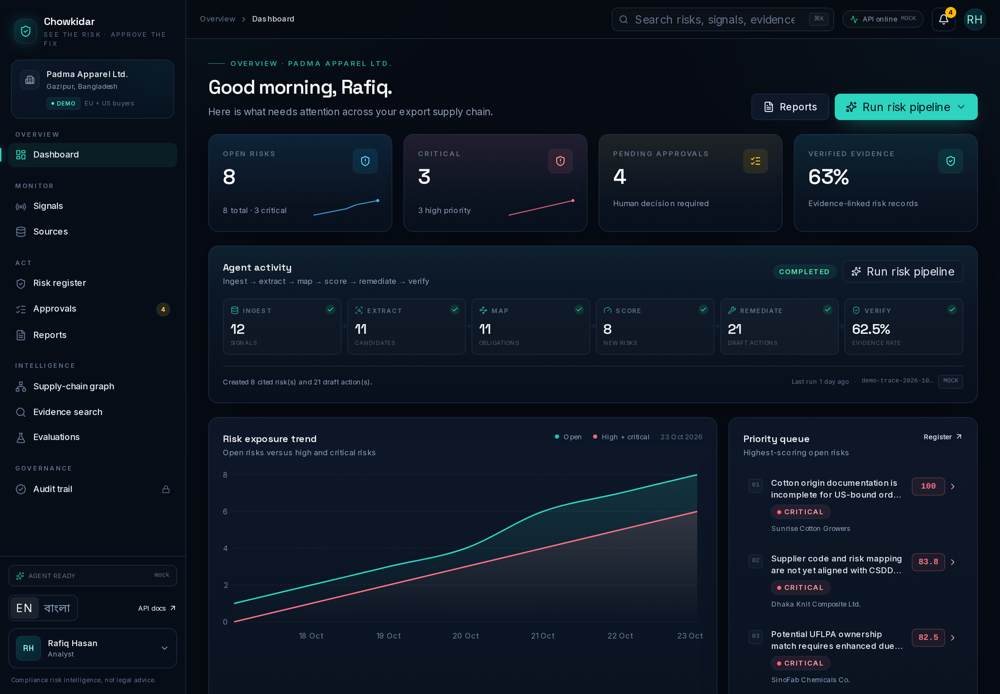
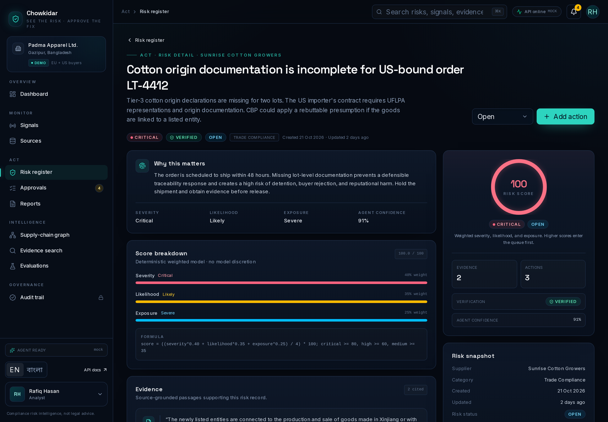
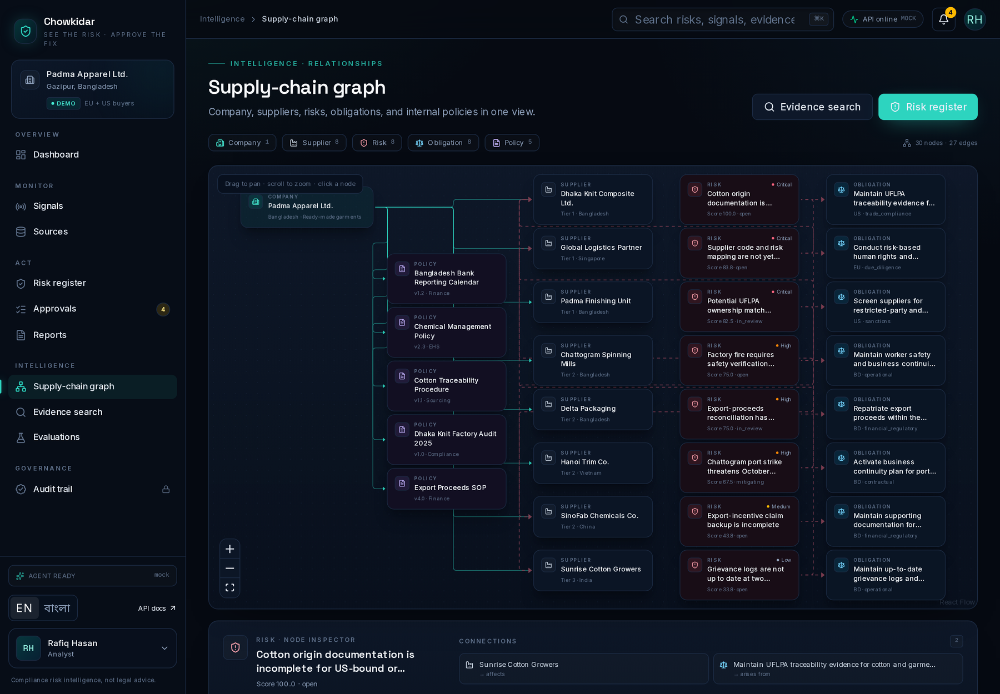
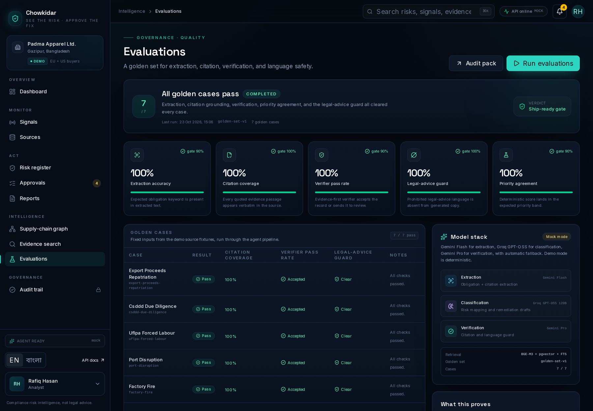

# Chowkidar — See the risk. Approve the fix.

**Compliance risk intelligence for export supply chains.**

**Event:** International AI Builders Congress 2026  
**Track:** Idea to Unicorn  
**Domain:** JusticeSphere AI  
**Challenge:** Risk Sentinel  
**Team:** JU_StackMind  
**Deadline:** 2026-10-31, 11:59 PM GMT+6

Chowkidar monitors regulatory, sanctions, and global risk streams; maps each signal to a company's obligations, suppliers, and controls; and produces a ranked, evidence-backed risk register with proposed remediation and a human approval gate.

The demo follows **Padma Apparel Ltd.**, a fictional ready-made-garment exporter in Gazipur, Bangladesh, selling to an EU buyer and a US buyer under a CSDDD + UFLPA scenario.

> Chowkidar provides compliance risk intelligence, not legal advice. Every finding is a reviewable signal, not a legal determination. A named human approves material actions.

---

## Screens

| Dashboard | Risk detail |
|---|---|
|  |  |

| Supply-chain graph | Evaluations |
|---|---|
|  |  |

More views: [signals](docs/assets/02-signals.png) · [search](docs/assets/05-search.png) · [approvals](docs/assets/07-approvals.png) · [audit](docs/assets/08-audit.png) · [login](docs/assets/00-login.png)

---

## Why this wedge

- Matches the Risk Sentinel brief directly: **two or more data streams → prioritized audit → remediation → human-in-the-loop approval**.
- Starts with a concrete Bangladesh beachhead (RMG, leather, agro exports) and expands to other export corridors.
- Treats citations, verification, and auditability as product features, not afterthoughts.
- Designed for teams without in-house legal counsel: source-grounded, conservative language, explicit limitations, and human sign-off.

---

## What is implemented

| Capability | Status |
|---|---|
| Risk dashboard with posture, trends, and source health | Built |
| Signal inbox with filters, source detail, and raw payload | Built |
| Risk register and risk detail with score breakdown and evidence | Built |
| LangGraph pipeline: ingest → extract → map → score → remediate → verify → persist | Built |
| Deterministic weighted risk score + LLM rationale | Built |
| Hybrid retrieval over cited evidence (pgvector + Postgres FTS) | Built |
| Evidence verifier and legal-advice guard | Built |
| Human approval queue with rationale and audit trail | Built |
| Append-only SHA-256 hash-chained audit log | Built |
| Reports in PDF, JSON, and Markdown | Built |
| Supply-chain graph and node inspector | Built |
| Evaluation dashboard with five metric gates | Built, 7/7 golden cases |
| Read-only MCP server | Built |
| FastAPI REST API + OpenAPI schema | Built |
| English + Bengali UI chrome | Built |
| Demo auth with four roles | Built; local only in `AUTH_MODE=dev` + `DEMO_MODE=true` |
| Supabase Auth production path | Live: password/refresh/logout proxy, JWKS verification, local role mapping, production login UI; four pilot accounts provisioned and hosted QA passed |
| Durable report storage | Built: local, Postgres, and private Supabase Storage backends; Postgres is live on the hosted API and survived a redeploy |
| Live LLM providers | Tested via LiteLLM fallback; mock mode is the hosted pilot default |
| Cloud deployment | Live production pilot: Render API + Netlify web primary, Vercel secondary fallback; see [`docs/CLOUD_DEPLOYMENT_STATUS.md`](docs/CLOUD_DEPLOYMENT_STATUS.md) |

### Demo accounts

| Role | Name | Email |
|---|---|---|
| Admin | Ayesha Rahman | `admin@chowkidar.demo` |
| Analyst | Rafiq Hasan | `analyst@chowkidar.demo` |
| Approver | Nusrat Jahan | `approver@chowkidar.demo` |
| Viewer | Imran Chowdhury | `viewer@chowkidar.demo` |

The login page asks the API for `/api/v1/auth/config`: the local demo shows one-click role cards, while the hosted pilot shows email/password. The hosted pilot uses managed accounts with the emails `admin@chowkidar.app`, `analyst@chowkidar.app`, `approver@chowkidar.app`, and `viewer@chowkidar.app`. Passwords are held only in the gitignored private access note and are not committed. Role permissions are enforced in the API and reflected in the UI. See [`docs/PRODUCTION.md`](docs/PRODUCTION.md).

---

## Architecture at a glance

```
EU / BD / US source feeds
        │
        ▼
FastAPI connectors + fixtures ──► Postgres (signals, obligations, risks, actions)
        │                              │
        ▼                              ▼
LangGraph agent pipeline          Hybrid retrieval (pgvector + FTS)
  extract → map → score            │
  → remediate → verify             ▼
        │                     Evidence citations
        ▼
Risk register + remediation + human approval + report
        │
        ▼
Next.js console · REST/OpenAPI · read-only MCP
```

- **Web:** Next.js App Router, TypeScript, Tailwind, shadcn-style components, TanStack Query, Zustand, Recharts, React Flow.
- **API:** FastAPI, SQLAlchemy 2, Alembic, Postgres + pgvector, REST/OpenAPI.
- **Agents:** LangGraph orchestration; LiteLLM fallback chain (Gemini Flash → Groq → Gemini Pro); deterministic mock mode for reproducible demos.
- **Trust:** verbatim evidence quotes, citation URLs, deterministic verifier, prohibited-phrase checks, hash-chained audit events, role-gated mutations.
- **Ops:** Docker Compose for local Postgres/Neo4j/Ollama/n8n, Render Docker blueprint for the API, Netlify for the primary web app, Vercel as the secondary fallback.

See [`docs/ARCHITECTURE.md`](docs/ARCHITECTURE.md) for detail.

---

## Run locally

### Prerequisites

- Node.js 22+, pnpm 12+
- Python 3.12+, [`uv`](https://docs.astral.sh/uv/)
- Docker (for Postgres with pgvector; Neo4j/n8n/Ollama are optional)

### Quick start

```bash
cp .env.example .env          # add keys only if you want live mode
make setup
make services-up
make migrate
make seed

# Terminal 1
make api

# Terminal 2
make web
```

Open **http://localhost:3000** and choose a demo account.

For a one-command fresh demo (starts Postgres, migrates, reseeds, then runs API and web):

```bash
make demo
```

`make demo` resets the seeded demo data on every launch. Use `make dev` to restart the apps without reseeding.

API docs: **http://localhost:8000/docs** · Health: **http://localhost:8000/healthz**

> Use `localhost`, not `127.0.0.1`, so the browser origin matches the configured CORS origin.

The default demo is fixture-first and deterministic: `LLM_MODE=mock`, no external AI keys needed. See [`docs/ENVIRONMENT.md`](docs/ENVIRONMENT.md) for the exact environment-variable matrix and the live-model recipe.

### Useful commands

```bash
make test          # pytest + Vitest
make e2e           # Playwright (API and web must be running)
make lint          # Ruff + ESLint
make typecheck     # Pyright + tsc
make check         # lint + typecheck + unit tests
make evals         # golden-set evaluation
make mcp           # read-only MCP server over stdio
make docker        # build the API container from the repo root
make api-types     # regenerate OpenAPI types (API must be running)
```

Reseed the demo after mutation testing:

```bash
cd apps/api && uv run python -m app.db.seed
```

---

## Demo flow (5 minutes)

1. **Dashboard** — Padma Apparel has 8 risks: 3 critical, 3 high, 1 medium, 1 low; 4 approvals are waiting.
2. **Signals** — EU CSDDD, Bangladesh Bank, UFLPA, and GDELT signals arrive with source citations.
3. **Run pipeline** — show the LangGraph stages; in mock mode the result is deterministic.
4. **Risk detail** — inspect the score breakdown, exact quote, citation, verifier status, and proposed actions.
5. **Approvals** — as Nusrat (approver), review the rationale and record a decision.
6. **Audit trail** — as Ayesha (admin), verify the hash chain and inspect the decision event.
7. **Reports** — generate a board-ready PDF, JSON, or Markdown audit pack.

---

## Evidence and trust model

- Every risk carries a **verbatim quote** and **citation URL** from the source signal.
- A deterministic verifier returns `verified`, `needs_review`, or `insufficient_evidence`.
- Output is checked for prohibited legal-advice phrases and prompt-injection markers.
- PII is redacted with regex and allowlists before storage/display.
- The risk score is transparent and auditable:
  `((severity × 0.40 + likelihood × 0.35 + exposure × 0.25) / 4) × 100`.
- Priority bands: `critical ≥ 80`, `high ≥ 60`, `medium ≥ 35`, `low < 35`.
- Material mutations append an audit event; each event commits to the previous SHA-256 hash.

### Current limitations

- Fixture-first pilot data; source connectors are not implemented or production-scheduled.
- No legal/compliance advisor; the product is deliberately positioned as decision support.
- The **live service is a production pilot**, not a demo: `AUTH_MODE=supabase`, `DEMO_MODE=false`, four provisioned accounts, and demo login disabled. It is still a single-workspace pilot, not a commercial multi-tenant service.
- Reports use the durable Postgres backend on the hosted API (`STORAGE_BACKEND=database`), with private Supabase Storage as an optional object-store adapter. Hosted reports survived an API redeploy with matching checksums; local `/tmp` reports remain only for offline demos.
- Rate limits are process-local (suitable for the single Render instance); browser tokens are stored in local storage rather than HttpOnly cookies.
- Live source connectors are not implemented; `DATA_MODE=live` is unsupported and source sync replays fixtures.
- Optional BGE-M3 embeddings, Docling, RAGAS, and Phoenix are not required for the demo path.
- Cloud deployment is live for the API and web build. Netlify is the primary web origin; Vercel remains a secondary fallback and still has DNS variability on some networks. The Netlify CORS cutover is pending, so the Vercel path is the currently verified browser login until Render is updated. See [`docs/CLOUD_DEPLOYMENT_STATUS.md`](docs/CLOUD_DEPLOYMENT_STATUS.md).

---

## MCP (optional)

Chowkidar exposes a **read-only** FastMCP server so other agents can inspect risks, evidence, approvals, and the supply-chain graph without mutating state.

```bash
make mcp
```

Example client config:

```json
{
  "mcpServers": {
    "chowkidar": {
      "command": "uv",
      "args": ["run", "--project", "apps/api", "python", "-m", "app.mcp.server"],
      "env": { "CHOWKIDAR_API_URL": "http://127.0.0.1:8000" }
    }
  }
}
```

Tools: `dashboard_summary`, `list_open_risks`, `get_risk`, `search_evidence`, `list_pending_approvals`, `supply_chain_graph`.  
See [`docs/MCP.md`](docs/MCP.md).

---

## Project docs

| Doc | Purpose |
|---|---|
| [`DECISIONS.md`](DECISIONS.md) | Decision log, constraints, session history |
| [`PRODUCT_SPEC.md`](PRODUCT_SPEC.md) | Personas, workflows, data model, agents, evals |
| [`BUILD_PLAN.md`](BUILD_PLAN.md) | Plan, cut list, submission checklist |
| [`STRATEGY.md`](STRATEGY.md) | Market and strategic case |
| [`docs/COMPETITION_CONTEXT.md`](docs/COMPETITION_CONTEXT.md) | Official form, scoring signals, screenshots, authoritative domains |
| [`prompts/MASTER_PROMPT.md`](prompts/MASTER_PROMPT.md) | Single master prompt used for the base build |
| [`docs/ARCHITECTURE.md`](docs/ARCHITECTURE.md) | System design and trust boundaries |
| [`docs/DATA_SOURCES.md`](docs/DATA_SOURCES.md) | Source inventory and access notes |
| [`docs/SETUP.md`](docs/SETUP.md) | Local setup, seed baseline, commands, troubleshooting |
| [`docs/ENVIRONMENT.md`](docs/ENVIRONMENT.md) | Variable reference, auth/storage/rate-limit modes |
| [`docs/DEPLOYMENT.md`](docs/DEPLOYMENT.md) | Local, Render, Netlify, Vercel, Supabase deployment |
| [`docs/PRODUCTION.md`](docs/PRODUCTION.md) | Production-pilot operations, Supabase Auth, credentials, hosted QA |
| [`docs/RUNBOOK.md`](docs/RUNBOOK.md) | Deploy, rollback, backup, key rotation, incidents |
| [`docs/API.md`](docs/API.md) | Endpoint reference, auth, errors, rate limits |
| [`docs/EVALS.md`](docs/EVALS.md) | Golden set, metrics, results, evaluation limits |
| [`docs/RESPONSIBLE_AI.md`](docs/RESPONSIBLE_AI.md) | No-legal-advice, evidence-first, privacy, human approval |
| [`docs/LIMITATIONS.md`](docs/LIMITATIONS.md) | What is not built or not enabled, and why |
| [`docs/DEMO_SCRIPT.md`](docs/DEMO_SCRIPT.md) | 2–3 minute demo shot list and narration |
| [`docs/PITCH_DECK.md`](docs/PITCH_DECK.md) | 10-slide pitch outline |
| [`docs/CLOUD_DEPLOYMENT_STATUS.md`](docs/CLOUD_DEPLOYMENT_STATUS.md) | Live URLs, hosted env vars, Netlify primary and Vercel fallback |
| [`docs/MCP.md`](docs/MCP.md) | Read-only MCP usage |
| [`docs/SUBMISSION.md`](docs/SUBMISSION.md) | Judge runbook, submission copy, asset checklist |
| [`docs/BUILD_LOG.md`](docs/BUILD_LOG.md) | Build level, prompts, models, manual changes |
| [`docs/COMMIT_CONVENTIONS.md`](docs/COMMIT_CONVENTIONS.md) | Commit history conventions |

---

## Build provenance

The base implementation was produced by an AI coding agent from a single master prompt (`prompts/MASTER_PROMPT.md` v1.0), with no iterative human prompting during the initial build pass. Subsequent QA fixes, tests, and documentation are recorded in [`docs/BUILD_LOG.md`](docs/BUILD_LOG.md). The event's build-level classification is left to the submission form; this repo reports what was actually done.

---

## Team

**JU_StackMind** · International AI Builders Congress 2026  
Event: https://cloudcampbd.com/ai-builders-congress  
Repository: https://github.com/A7reus/Chowkidar

- **Live production pilot:** <https://ch0wkidar.netlify.app/> (Netlify primary; Supabase email/password; CORS cutover pending). Verified browser fallback: <https://chowkidar-wheat.vercel.app/> (Vercel DNS may vary on some networks).
- **API:** <https://chowkidar-api.onrender.com/>
- **Video:** pending recording.
